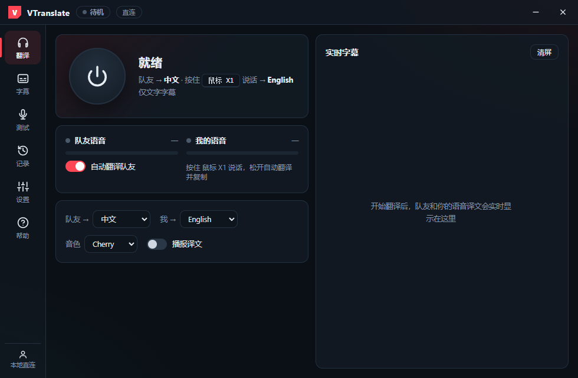

# VTranslate — Valorant 实时语音翻译伴侣

队友说英文，你看到中文字幕；你按住热键说话，队友听到英文播报。



## 功能一览

- **游戏内即用**：全局 PTT 热键支持键盘与鼠标侧键；打包版以管理员运行，Vanguard 提权的游戏窗口聚焦时同样有效
- **双向翻译**：
  - 队友流 —— 系统回环采集游戏音频，多人语音自动分说话人各自成段，实时出目标语言字幕
  - 自身流 —— 按住说话松开翻译，译文可播报给队友、可自动复制进游戏聊天框
- **字幕悬浮窗**：置顶防抢占、鼠标穿透、位置锁定、一键折叠成顶栏、拖拽/缩放、原文译文分色与字号/淡出可调
- **两种运行模式**：
  - **计费服务器（推荐）**：自建中转服务，账号/游客/试用额度/充值/订阅/推广返利齐全，客户端可在服务端白名单内自选翻译模型
  - **直连 DashScope**：自带 API Key，端点与模型名完全自定义
- **术语热词**：内置 230+ 条 Valorant 双向术语（特工/技能/地图/点位/枪械/经济/战术黑话），服务器模式还可在管理后台在线维护
- **双语界面**（中文/English）、托盘常驻（开始/停止、字幕开关、穿透、锁定）
- **Web 管理后台**：仪表盘、用户与订单管理、用量明细、实时会话监控、热词与运行参数在线调整

## 仓库结构

| 目录 | 说明 |
| --- | --- |
| `server/` | FastAPI 计费服务 + WebSocket 翻译中转 + 管理 API；`server/admin/` 为后台静态页（托管在 `/admin`） |
| `client-electron/` | Windows Electron 客户端；密钥与翻译会话只存在于主进程，渲染层经 IPC 白名单通信 |
| `deploy/` | Docker Compose / nginx 反代 / systemd / 一键安装脚本 |
| `docs/` | 截图与文档 |

## 服务端快速开始

```bash
cd server
pip install -r ../requirements-server.txt

# 本地调试（无 Key，伪造上游回显）
MOCK_UPSTREAM=1 ADMIN_TOKEN=admintest ZPAY_KEY=testkey ZPAY_PID=1000 \
DB_PATH=_verify.db python -m uvicorn app:app --host 127.0.0.1 --port 8765

# 冒烟测试（另开会话执行；结束后删除 _verify.db*）
ZPAY_KEY=testkey python smoke_test.py      # 计费/中转/限流等 15 项
ADMIN_TOKEN=admintest python admin_test.py # 管理 API
```

生产部署见 [`deploy/README.md`](deploy/README.md)：环境变量清单在 [`server/.env.example`](server/.env.example)（DashScope Key、Z-Pay 商户信息、`ALLOWED_MODELS` 模型白名单等）。

> 服务端仅支持单进程运行（SQLite + 进程内状态），切勿多 worker / 多实例指向同一个 DB。

## 客户端构建

```bash
cd client-electron
npm ci   # Electron 下载慢时：ELECTRON_MIRROR=https://npmmirror.com/mirrors/electron/

# 开发运行
npm start

# 打包 Windows 便携版 -> dist/VTranslate.exe（需管理员权限运行，游戏内热键依赖）
npx electron-builder --win portable -c.electronDist=node_modules/electron/dist
```

## 安全模型

- DashScope Key / 服务器 token 只写入主进程本地配置，渲染层不可读、不可写
- 渲染层可写的配置键与可调用的 IPC 通道均为白名单制；翻译 WebSocket 由主进程持有（Authorization 头不进 URL）
- 服务器模式下模型选择受服务端白名单约束，不开放任意模型名
- 剪贴板写入统一走主进程，避免窗口失焦时静默失败

## License

[MIT](LICENSE)
